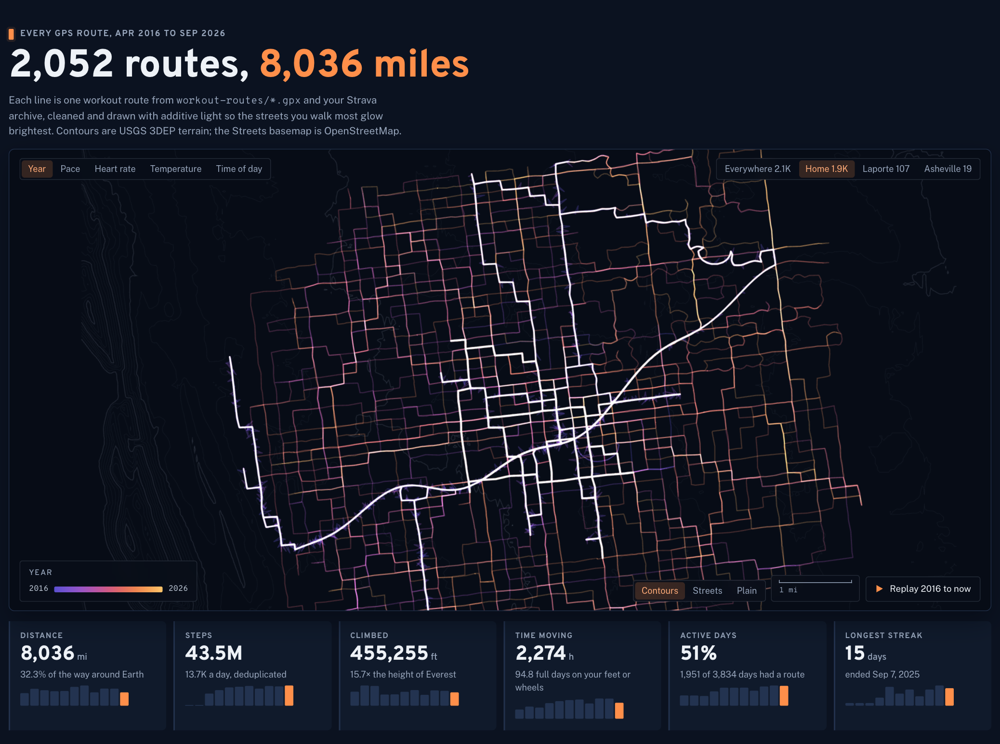
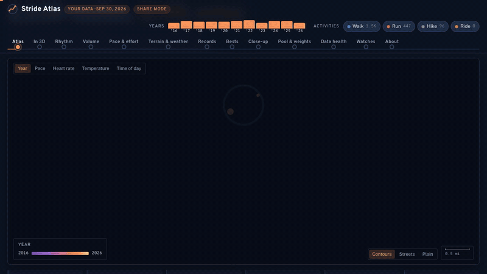
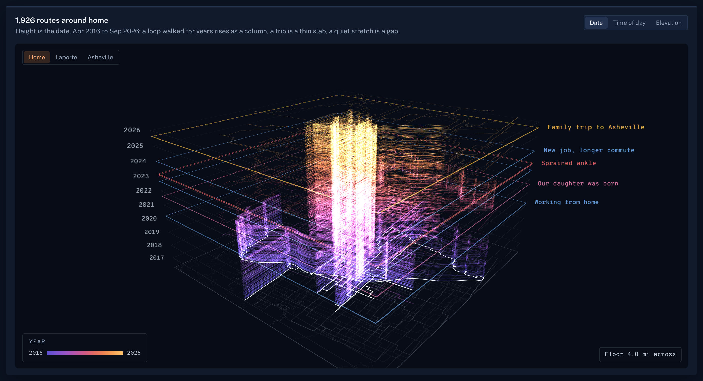
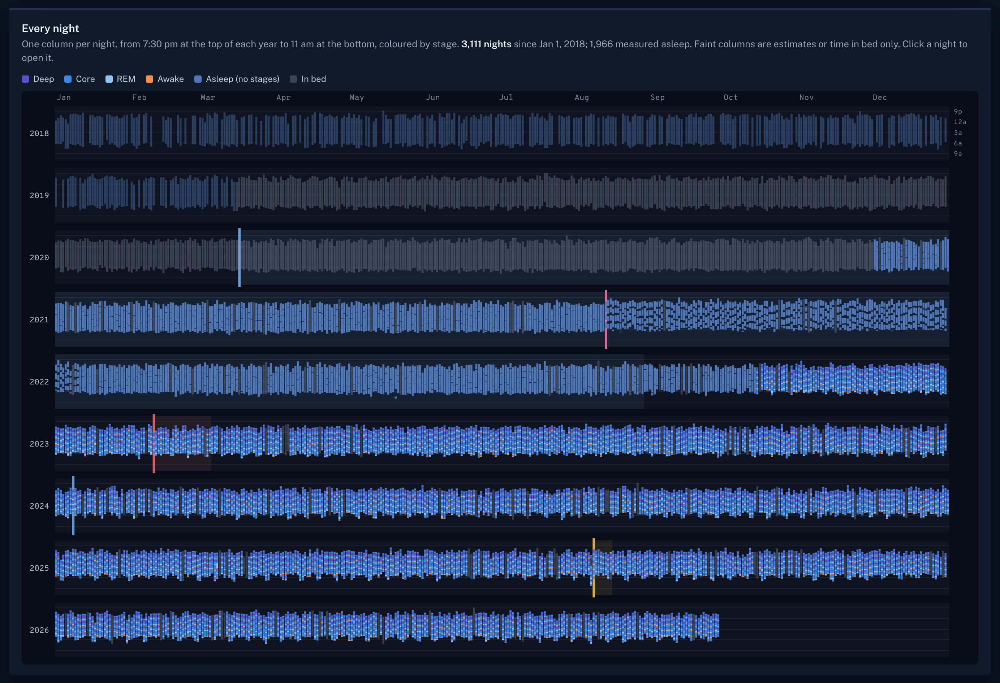
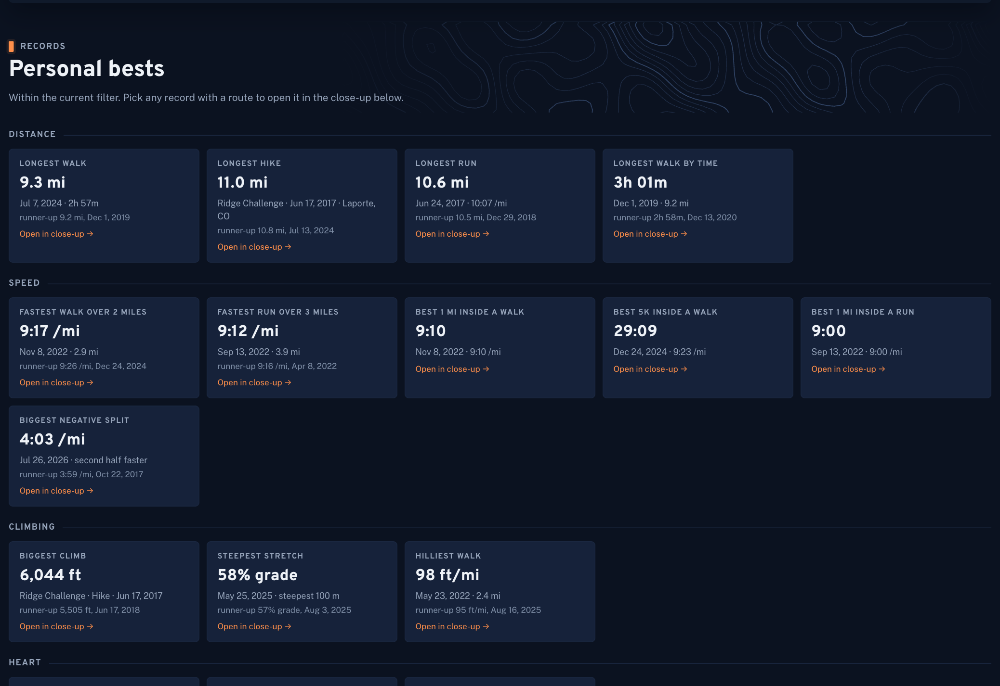
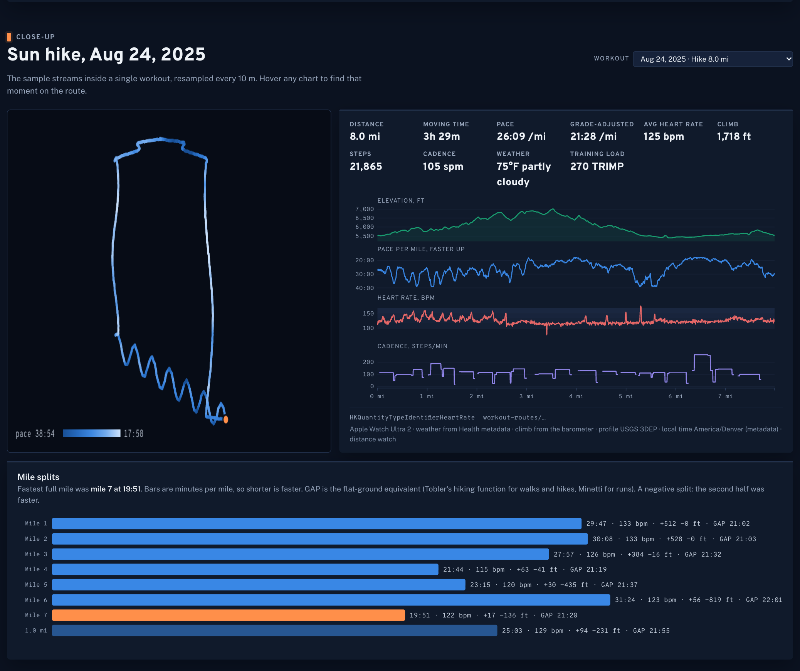
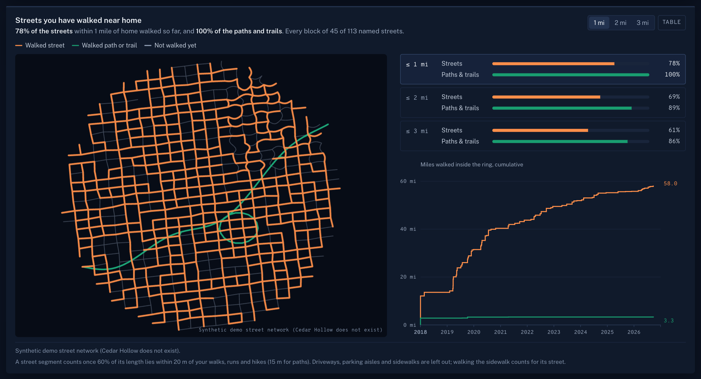
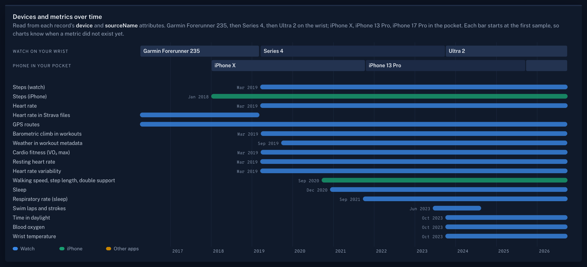

<p align="center"></p>

# Stride Atlas

[](https://github.com/dogum/stride-atlas/actions/workflows/ci.yml) [](LICENSE)

**[Open the live demo →](https://dogum.github.io/stride-atlas/)** · [watch the 70-second tour](https://dogum.github.io/stride-atlas/?present=1) · synthetic data for a person who does not exist

**Your Apple Health export as a map and a story.** Every walk, run, hike and ride you have recorded, cleaned, enriched
with weather and terrain, and drawn as a local dashboard on your own computer. No accounts, no cloud, nothing uploaded.

Clone it, drop in your export, and run one command, or open the folder in [Claude Code](https://claude.com/claude-code)
and say *"build this for my data."*

<p align="center"></p>

## What you get

Thirteen chapters, all computed from your data:

| | |
|---|---|
| **Atlas.** Every GPS route as additive light: the streets you walk most glow brightest. Color by year, pace, heart rate, temperature or time of day; replay the years; click any line. | **In 3D.** The same routes stacked by date, so the loops you have walked for years rise as towers; switch the height to time of day or to the ground's elevation and watch them move. |
| **Rhythm.** Every day since your first export as a calendar, your walking clock year by year, hour by weekday. | **Volume.** Cumulative miles year against year, miles by activity, weekly totals. |
| **Pace and effort.** Every workout's pace, pace against temperature (raw and weather-adjusted), heart rate at the same pace, zones, resting heart rate and VO₂ max, gait from the phone. **Heart and movement:** how fast your heart recovers after each workout, walking steadiness and stair speed. | **Terrain and weather.** Temperature at the start of every outing (from Health, else the nearest weather station), sky conditions, climbing, how hilly your routes are. |
| **Records.** Longest, fastest, steepest, hottest, coldest, earliest, darkest, most in a day, week, month and year, each one a click away from its route. | **Bests.** Best efforts found inside every GPS track, your favourite loops raced against themselves, a fitness and fatigue model, the Eddington number, new ground, and the share of streets near home you have walked. |
| **Close-up.** One workout second by second: the route coloured by pace, elevation, pace and heart-rate streams, mile splits with grade-adjusted pace. | **Pool and weights.** Swims with laps, strokes and SWOLF; strength sessions; indoor rides. |
| **Data health.** Every cleaning rule and how often it fired, one route raw against cleaned, why steps need deduplicating. | **Watches.** When each device and each metric first appeared, so a missing value is never read as a zero. |

<p align="center"></p>

**And a Sleep page.** Every night since your first sleep record as one picture, coloured by stage; hours asleep and when
you fall asleep and wake, year by year and night of the week; deep, core and REM, and a typical night lined up at the
moment you fell asleep; one night stage by stage; heart rate, HRV, breathing, blood oxygen, wrist temperature and
breathing disturbances measured while asleep; records; and where each night came from. A Breathing chapter lays the
watch's sleep apnea notifications over their 30-day windows and fits the simplest rule that explains them on your own
data (a reconstruction, not a diagnosis; share mode leaves it out). Exports mix a lot of sleep
sources (another watch, sleep apps, the phone's bedtime schedule, the Apple Watch before and after stages), often for
the same night: each night keeps one, and old sleep-window trackers are marked as estimates rather than read as sleep.

<p align="center"></p>

**Life milestones.** Add the dates that explain your data (a child born, working from home, a new commute, a move, an
injury) and they appear faintly on every chart with a date axis, on both pages, in the map replay and as rings in the 3D
stack. Click **Milestones** in the app or edit `data/milestones.yaml`; they stay on your computer, and share mode hides
their labels.

<p align="center">
 
 
</p>

The screenshots show **Alex, who does not exist**: `make demo` writes a synthetic export for a procedural town laid
over real terrain near Fort Collins, Colorado, with eight years of watch and phone data and an older Strava archive.

## Try it in two minutes (no export needed)

Or skip the install: the [live demo](https://dogum.github.io/stride-atlas/) is this same build, published by
`.github/workflows/pages.yml` from `make demo` and `make site`.

```bash
git clone https://github.com/dogum/stride-atlas.git && cd stride-atlas
make setup      # uv sync + npm install
make demo       # synthetic export → the whole pipeline (about 8 minutes the first time; weather and terrain are fetched once)
make dev        # http://localhost:5173
```

Requirements: [uv](https://docs.astral.sh/uv/) (it installs Python 3.12), Node 20+, and on macOS or Linux the usual
`make` and `unzip`. Optional: Google Chrome or Chromium for headless screenshots and video, `ffmpeg` for video.

## Build it for your own data

1. **Export from the Health app.** On your iPhone: Health → your profile picture → **Export All Health Data**. AirDrop
   the zip to your computer and put it in `data/` (any name).
2. **Optional: your Strava archive**, if you used another watch before your Apple Watch: strava.com → Settings → My
   Account → Download or Delete Your Account → *Request your archive*. Put that zip in `data/` too. Only its activities
   are read; overlaps with Health (a Peloton class saved by both, say) are merged.
3. **Run it.**
   ```bash
   cp config.example.yaml config.yaml   # set units: imperial or metric
   make all                             # about 10 minutes for a large export the first time
   make dev
   ```
4. **Check it.** `reports/06_validation.md` lists ten random workouts with blank columns to fill from the Fitness app,
   monthly step totals to compare with Health, and every record with its date.
5. **Optional: milestones.** `cp milestones.example.yaml data/milestones.yaml` and edit it, or use the Milestones button.

### With Claude Code

Open the folder in Claude Code and say **"build this for my data."** It follows [`CLAUDE.md`](CLAUDE.md): runs each phase,
reads the inventory of your export, adapts to whatever your export does differently, logs every judgment call in
`data/DECISIONS.md` (next to your data, never committed; the defaults are in [`docs/DECISIONS.md`](docs/DECISIONS.md)), reads the extremes of every record before trusting them, reviews every chart,
and hands you the validation report. [`docs/PLAYBOOK.md`](docs/PLAYBOOK.md) is everything the first build learned, so
it does not have to be rediscovered.

## Privacy

- Everything runs on your computer. The app reads only its own `/data` folder; fonts and scripts are bundled.
- The only network calls are cached lookups: hourly weather (NOAA stations and Open-Meteo, with locations rounded to a
  0.25° grid), terrain (USGS 3DEP tiles on a fixed grid) and one OpenStreetMap regional extract. Nothing is sent about
  you. A second run makes no calls at all.
- Your home is detected from where routes start and stays in the local database. **Share mode** (a button in the app,
  or `?share=1`) hides the start and end of routes near home and a zone around it, for screenshots and videos.
- `data/`, `app/public/data/` and `reports/` are git-ignored. Never commit them.

## How it works

```
export.zip ─▶ inventory ─▶ parse ─▶ strava ─▶ clean ─▶ enrich ─▶ derive ─▶ export ─▶ app
             (Phase 0)    DuckDB   optional   rules    weather,   metrics,   Parquet,   React + D3
                                              G1–G6,   terrain,   records,   route      + deck.gl
                                              W1–W5,   sun,       loops,     buffers
                                              S1, H1–H3 streets   fitness
```

- **Pipeline:** Python 3.12 with `lxml` (streaming a multi-GB XML), DuckDB, numpy/scipy, `requests-cache`, `osmnx` and
  `pyosmium`, `fitdecode`. Every cleaning change is logged in `cleaning_log`; every enriched value has a provenance
  column.
- **App:** Vite, React and TypeScript; D3 for charts; deck.gl for the atlas (hundreds of thousands of points at 60 fps,
  filtered on the GPU); Parquet read in the browser with hyparquet.
- **Specs:** [`HEALTH_EXPORT.md`](docs/HEALTH_EXPORT.md) (what is in an export, including Strava's),
  [`CLEANING.md`](docs/CLEANING.md) (every rule), [`ENRICHMENT.md`](docs/ENRICHMENT.md) (every outside source),
  [`METRICS.md`](docs/METRICS.md) (every number on screen).

## Make a video

```bash
make dev                               # in one terminal
node scripts/record.mjs                # 1920×1080, in share mode, into data/video/
node scripts/record.mjs --vertical     # 1080×1920 for Reels, TikTok and Shorts
node scripts/record.mjs --short        # 15 seconds of what is new, for posting an update (add --vertical for phones)
```

About 70 seconds, written from your data and cut to the beat: every route replayed under the title, a flight home, the
map recoloured four ways, your routes rising in 3D, then one stop per chapter with a pointer pressing the real toggles
(a fingertip on the vertical cut), and an end card. Each run writes a silent copy and a `-music` copy with an original
soundtrack synthesised to the tour's own timeline (`pipeline/stride/soundtrack.py`, so there is nothing to license);
swap in your platform's music if you prefer. Open `?present=1` and press Play to watch it live.
`node scripts/shoot.mjs streets records` takes headless screenshots of any panel.

## Useful commands

`make help` lists everything. The ones you will use: `make all`, `make dev`, `make test`, `make validate`,
`make verify-clean` (rebuild from the raw export and compare every output hash), `make weather-compare` (how the weather
sources agree with Apple's own temperatures for you), `make demo`. `node scripts/perf.mjs` (add `--software --cpu 4` for
a computer without graphics acceleration) measures how the page draws while it sits still and while it scrolls.

## Sources and credits

Weather: [Open-Meteo](https://open-meteo.com) historical archive (CC BY 4.0), [NOAA NCEI GHCNh](https://www.ncei.noaa.gov/products/global-historical-climatology-network-hourly)
(public domain), optionally [NASA POWER](https://power.larc.nasa.gov). Terrain: [USGS 3DEP](https://www.usgs.gov/3d-elevation-program)
(public domain). Streets: © [OpenStreetMap](https://www.openstreetmap.org/copyright) contributors (ODbL), extracts by
[Geofabrik](https://download.geofabrik.de). Place names: [GeoNames](https://www.geonames.org) (CC BY 4.0) via
`reverse_geocoder`. Fonts: Overpass, Public Sans, Overpass Mono (SIL OFL). Not affiliated with Apple or Strava.

## Contributing

Bug reports, export quirks, new data sources and new charts are all welcome. Read [CONTRIBUTING.md](CONTRIBUTING.md)
first: the one hard rule is that nothing from a real export ever goes into an issue or a pull request (`make demo`
reproduces almost anything). What changed in each release is in [CHANGELOG.md](CHANGELOG.md).

## License

MIT. See [LICENSE](LICENSE).

<sub>Made by [Greg Dogum](https://github.com/dogum) with [Claude Code](https://claude.com/claude-code).</sub>
